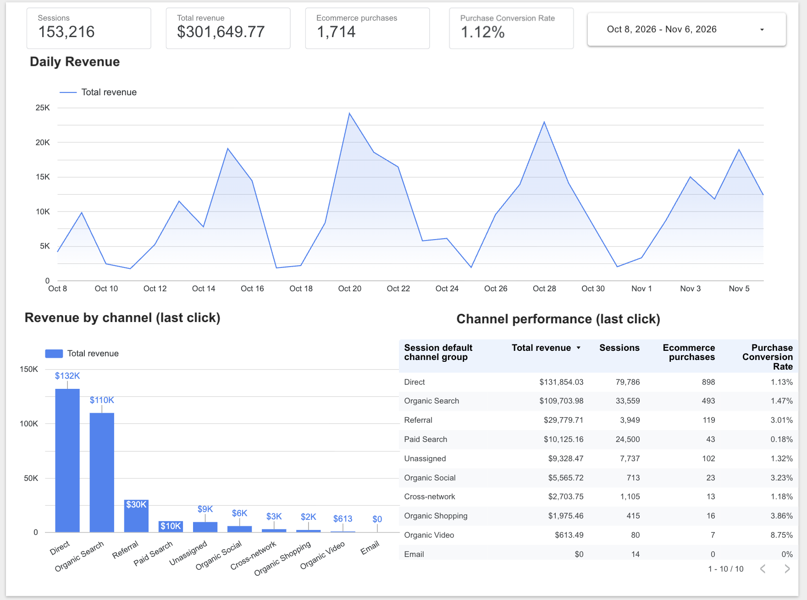
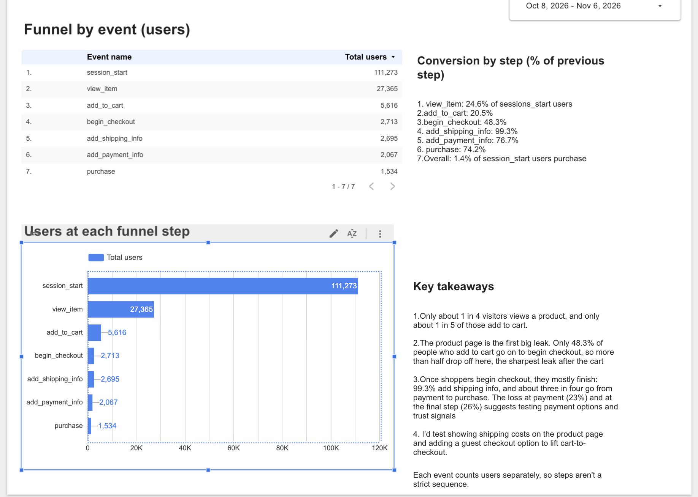
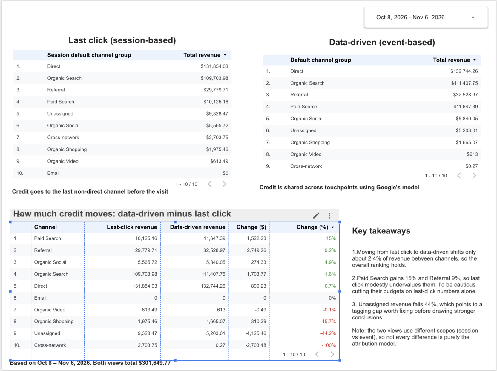

# Ecommerce Marketing Performance Dashboard

**Live dashboard:** https://datastudio.google.com/reporting/79b58324-c390-431b-b985-67e694342874
**Tools:** Looker Studio (Data Studio), GA4, Google Sheets
**Data:** Google Merchandise Store demo data (public), Oct 8 – Nov 6, 2026

## What I wanted to find out
- Where does the store's revenue come from?
- Where do shoppers drop off before buying?
- How much does credit for a sale change between last-click and data-driven attribution?

## What's in the dashboard
1. **Overview:** sessions, revenue, purchases, conversion rate, daily revenue, revenue by channel
2. **Funnel:** how many users reach each step, from visiting to buying
3. **Attribution:** last-click vs data-driven revenue by channel

## Key findings
**Overview**
- Direct and Organic Search bring in about 80% of revenue.
- Paid Search is 16% of sessions but converts at only 0.18% (overall: 1.12%).
- About $9.3K of revenue is "Unassigned", which suggests a tracking gap.

**Funnel**
- Only about 1 in 4 visitors views a product, and about 1 in 5 of those adds to cart.
- Fewer than half of people who add to cart start checkout. This is the biggest drop after the cart.
- Idea to test: show shipping costs earlier and offer guest checkout.

**Attribution**
- Both methods count the same total revenue. Only the split between channels changes, and only about 2.4% of revenue moves.
- Paid Search gets 15% more credit under data-driven, so last click undersells it. I wouldn't cut its budget based on last click alone.
- "Unassigned" revenue (sales GA4 couldn't link to a channel) drops 44%, which points to a tracking gap worth fixing.

## Things to know
- Overview counts purchase events (1,714). Funnel counts unique buyers (1,534).
- The attribution comparison puts a session-based field next to an event-based one, so not every difference comes from the attribution model alone.
- This is public demo data, and GA4 can change past numbers slightly.

## Screenshots

