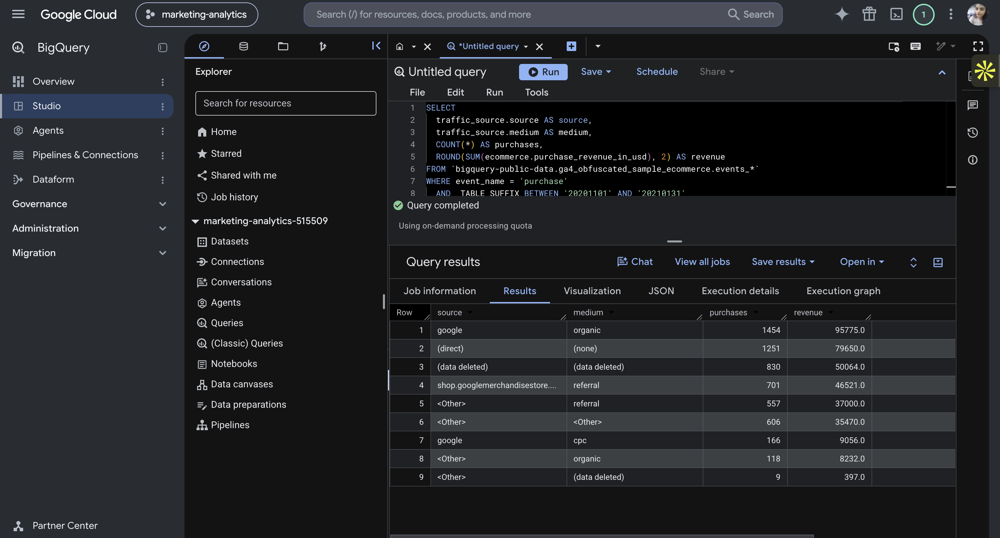
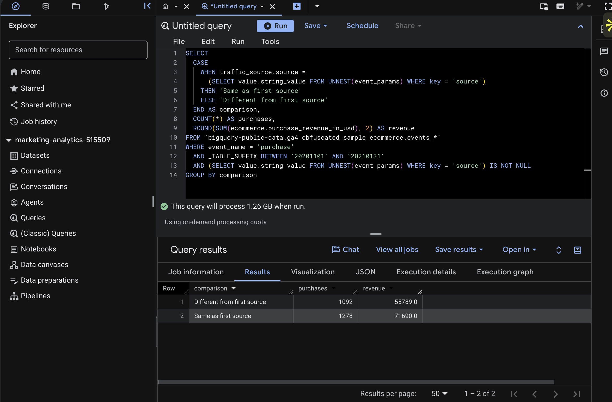

# Attribution Analysis in BigQuery (SQL)

**Tools:** BigQuery (sandbox), SQL
**Data:** Google Merchandise Store GA4 sample dataset (public), 1 Nov 2020 – 31 Jan 2021

## What I wanted to find out
- Which traffic sources do purchases and revenue come from?
- How often does the source recorded at purchase differ from the visitor's first source?

## Queries
All queries are in queries.sql in this folder.

## Findings

**Query 1: revenue by first traffic source** (5,692 purchases, $362K)
- Google organic and direct are the biggest first sources, together about 48% of revenue.
- Paid Google (cpc) brings only about 2.5% of revenue.
- About 36% of revenue sits in rows with placeholder sources, a limit of the obfuscated data.
- Order value is similar across sources, about $60 to $70.

**Query 2: first source vs source at purchase** (2,370 purchases)
- About 54% of purchases match the first source and up to 46% differ.
- Same-source purchases are worth slightly more per order ($56 vs $51).
- 46% is an upper limit, because placeholder values count as "different".
- A sizeable share of buyers may arrive through a different source than they started with, so crediting a single touchpoint misses part of the journey.

## Screenshots

## Notes
- This is a different dataset from my dashboard project, so the numbers don't match.
- The sample data is obfuscated, so some fields hold placeholder values. This is practice data, not a basis for real business decisions.
- Query 2 covers only the 42% of purchases that carry a source at purchase time.
